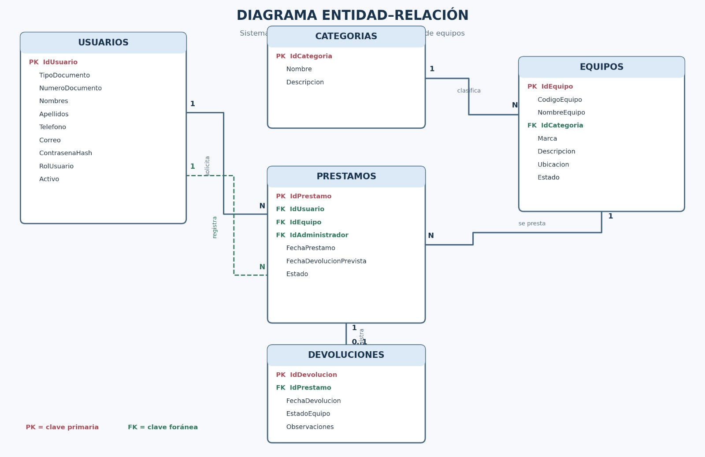

# Sistema de Préstamo de Equipos

<p align="center">
  
  
  
</p>

<p align="center">
  <strong>Una solución para organizar, controlar y gestionar el préstamo de equipos.</strong>
</p>

## 📌 Sobre el proyecto

El Sistema de Préstamo de Equipos es un proyecto integrador orientado a la administración y el control de los equipos que se prestan a los usuarios de una organización.

Su propósito es centralizar la información de los usuarios, mantener un registro de los equipos y facilitar el seguimiento de los préstamos y las devoluciones.

La base de datos está diseñada para mantener la integridad de la información mediante claves primarias, claves foráneas y restricciones de validación.

## 🎯 Objetivos

🧑‍💻 Gestionar la información de los usuarios y sus roles.

🖥️ Organizar el inventario y el estado de los equipos.

📋 Registrar los préstamos y las fechas de devolución.

🔎 Facilitar el seguimiento de los préstamos y las devoluciones registradas.

🔐 Mantener la consistencia y la integridad de los datos.

## 🛠️ Tecnologías

| Tecnología | Uso |
|---|---|
| ☕ Java | Desarrollo de la aplicación, si corresponde a la configuración del proyecto. |
| 🌐 Vaadin | Construcción de la interfaz web, si está incluido en el proyecto. |
| 📦 Maven | Gestión y compilación del proyecto Java. |
| 🗄️ Microsoft SQL Server | Administración de la base de datos. |
| 🧰 SQL Server Management Studio | Ejecución y administración del script SQL. |
| 🐳 Docker | Construcción de una imagen de la aplicación, si se utiliza. |

## 🗃️ Estructura de la base de datos

La base de datos `SistemaPrestamosEquipos` está compuesta por cuatro tablas principales que trabajan conjuntamente para organizar la información del sistema.

### 👥 1. Usuarios

Almacena la información personal y de acceso de las personas registradas.

| Campo | Descripción |
|---|---|
| IdUsuario (PK) | Identificador único del usuario. |
| TipoDocumento | Tipo de documento de identidad. |
| NumeroDocumento | Número de documento único. |
| Nombres | Nombres del usuario. |
| Apellidos | Apellidos del usuario. |
| Telefono | Número de contacto. |
| Correo | Correo electrónico único. |
| ContrasenaHash | Campo destinado al hash de la contraseña. |
| RolUsuario | Rol: Usuario o Administrador. |
| Activo | Indica si la cuenta está activa. |

### 🏷️ 2. Categorias

Almacena las categorías utilizadas para clasificar y organizar los equipos registrados en el sistema.

| Campo | Descripción |
|---|---|
| IdCategoria (PK) | Identificador único de la categoría. |
| Nombre | Nombre de la categoría. |
| Descripcion | Información adicional sobre la categoría. |

### 💻 3. Equipos

Almacena la información de los equipos disponibles para préstamo, incluyendo su categoría, ubicación y estado actual.

| Campo | Descripción |
|---|---|
| IdEquipo (PK) | Identificador único del equipo. |
| CodigoEquipo | Código único y obligatorio del equipo. |
| NombreEquipo | Nombre del equipo. |
| IdCategoria (FK) | Categoría a la que pertenece el equipo. |
| Marca | Fabricante o marca del equipo. |
| Descripcion | Características o información adicional del equipo. |
| Ubicacion | Lugar donde se encuentra el equipo. |
| Estado | Estado actual del equipo. |

### 📋 3. Prestamos

Registra las operaciones relacionadas con el préstamo de equipos.

| Campo | Descripción |
|---|---|
| IdPrestamo (PK) | Identificador único del préstamo. |
| IdUsuario (FK) | Usuario que solicita el equipo. |
| IdEquipo (FK) | Equipo asociado al préstamo. |
| IdAdministrador (FK) | Administrador que registra el préstamo. |
| FechaPrestamo | Fecha en la que se realiza el préstamo. |
| FechaDevolucionPrevista | Fecha límite prevista para la devolución. |
| Estado | Estado actual del préstamo. |

### 🔄 4. Devoluciones

Registra la información correspondiente a la devolución de los equipos.

| Campo | Descripción |
|---|---|
| IdDevolucion (PK) | Identificador único de la devolución. |
| IdPrestamo (FK) | Préstamo al que pertenece la devolución. |
| FechaDevolucion | Fecha efectiva en la que se recibe el equipo. |
| EstadoEquipo | Condición en la que se recibe el equipo. |
| Observaciones | Información adicional sobre la devolución. |

## 🔗 Relaciones entre las tablas

Las tablas del sistema se relacionan de la siguiente manera:

- **Usuarios → Prestamos (1:N):** identifica a la persona que solicita el equipo.
- **Usuarios → Prestamos (1:N):** identifica al administrador que registra la operación.
- **Equipos → Prestamos (1:N):** identifica el equipo relacionado con cada préstamo.
- **Prestamos → Devoluciones (1:0..1):** permite registrar cero o una devolución por cada préstamo.

Las relaciones se implementan mediante claves foráneas, que evitan registrar referencias a usuarios, administradores, equipos o préstamos inexistentes.

## 📊 Diagrama entidad-relación

El modelo de datos se representa mediante las tablas Usuarios, Equipos, Prestamos y Devoluciones.



## ⚙️ Reglas de integridad

La base de datos incluye restricciones para proteger la consistencia de la información:

✅ Los identificadores se generan automáticamente.

✅ El número de documento, el correo y el código del equipo deben ser únicos.

✅ Los roles se limitan a los valores permitidos.

✅ La fecha prevista de devolución no puede ser anterior a la fecha del préstamo.

✅ Cada devolución debe estar asociada a un préstamo existente.

✅ Un préstamo solo puede tener una devolución registrada.

✅ Las claves foráneas mantienen las relaciones entre las tablas.

## 🚀 Instalación y ejecución

### 1. Preparar la base de datos

Abre Microsoft SQL Server Management Studio.

Conéctate a una instancia de SQL Server.

Abre el archivo SQL del proyecto.

Ejecuta el script para crear la base de datos `SistemaPrestamosEquipos` y las tablas.

Comprueba que existan Usuarios, Equipos, Prestamos y Devoluciones.

**Importante:** si la base de datos ya existe, el comando `CREATE DATABASE` puede producir un error. Verifica su existencia antes de volver a ejecutar el script.

### 2. Ejecutar la aplicación

Si el proyecto está configurado con Java, Maven y Vaadin, abre la carpeta del proyecto en tu IDE y ejecuta la clase principal Application.

También puedes iniciar la aplicación desde una terminal en la raíz del proyecto:

```bash
./mvnw
```

En Windows:

```bat
mvnw.cmd
```

### 3. Compilar el proyecto

Para generar el paquete de la aplicación:

```bash
./mvnw package
```

En Windows:

```bat
mvnw.cmd package
```

Antes de ejecutar estos comandos, verifica que tengas un JDK compatible y que la conexión con SQL Server esté configurada correctamente.

## 📈 Alcance del proyecto

El script SQL define la estructura de la base de datos, las relaciones y las restricciones de integridad.

Las funcionalidades de interfaz, autenticación, gestión de préstamos, registro de devoluciones, actualización de estados y detección de préstamos vencidos deben implementarse en la aplicación según los requisitos del proyecto.

## 👨‍💻 Equipo de trabajo

Proyecto Integrador B1 · Periodo 2026-2 · Grupo G7

Integrantes: Sofía Marín - Cristian Naranjo - Staly Gonzales - Juan Carlos de la Cruz.

Programa de formación: Técnico Laboral en Asistente en Desarrollo de Software

Institución: CESDE | bello | Regular

<p align="center">
  💜 <strong>Proyecto Integrador · 2026-2</strong>
  <br>
  <sub>Sistema de Préstamo de Equipos</sub>
</p>
